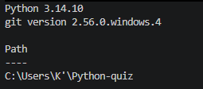

# Python Quiz
Python 기초 문법과 객체지향 프로그래밍을 활용한 콘솔 기반 퀴즈 게임

## 목차

1. [프로젝트 개요](#1-프로젝트-개요)
2. [주제 선정 이유](#2-주제-선정-이유)
3. [개발 환경](#3-개발-환경)
4. [프로젝트 구조](#4-프로젝트-구조)
5. [주요 기능](#5-주요-기능)
6. [클래스 및 코드 구조](#6-클래스-및-코드-구조)
7. [데이터 저장 및 관리](#7-데이터-저장-및-관리)
8. [설치 및 실행 방법](#8-설치-및-실행-방법)
9. [테스트 및 검증](#9-테스트-및-검증)
10. [실행 화면](#10-실행-화면)
11. [Git 및 GitHub 관리](#11-git-및-github-관리)
12. [학습 내용 및 문제 해결](#12-학습-내용-및-문제-해결)
13. [최종 제출 체크리스트](#13-최종-제출-체크리스트)

---

## 1. 프로젝트 개요

### 1-1. 프로젝트 소개

Python Quiz는 Python 기초 문법과 객체지향 프로그래밍을 학습하기 위해 제작한 콘솔 기반 퀴즈 프로그램으로 사용자는 프로그램의 메뉴를 통해 퀴즈 출제, 퀴즈 등록, 퀴즈 목록 조회, 최고 점수 확인 등의 기능을 이용할 수 있다.

기본 기능 외에도 랜덤 출제, 출제 문제 수 선택, 힌트 사용 및 점수 차감, 퀴즈 삭제, 점수 기록 히스토리 기능을 추가하여 프로그램의 활용성을 확장하였으며, 퀴즈 데이터와 게임 기록은 JSON 파일에 저장하여 프로그램을 종료하고 다시 실행해도 데이터가 유지되도록 구현하였다.

### 1-2. 프로젝트 목표

- Python 기본 자료형과 제어문 활용
- 함수와 클래스의 역할 이해
- 객체지향 프로그래밍 구현
- 리스트와 딕셔너리를 이용한 데이터 관리
- JSON 파일 입출력 구현
- try/except를 활용한 예외 처리
- Git 브랜치 생성 및 병합
- GitHub 저장소 관리 및 복제 실습

## 2. 주제 선정 이유

### 2-1. 주제 선정

**일반인들이 흥미있어 하는 우주이야기(천체물리학)**

### 2-2. 선정 이유

우리가 살아가는 지구와 우주의 원리를 이해하고, 평소 접하기 어려운 다양한 천문 현상에 대한 호기심을 넓히고자 한다. 태양계의 행성부터 블랙홀, 별의 탄생과 소멸, 우주의 기원과 팽창까지 폭넓은 내용을 퀴즈로 구성하여 과학적 사고력과 탐구심을 기를수 있도록 구성했다.

### 2-3. 퀴즈 구성

| 구분 | 학습 내용 |
|---|---|
| 태양계와 행성 | 태양, 행성, 달, 소행성, 생명체 거주 가능 영역|
| 별의 탄생과 진화 | 핵융합, 주계열성, 적색거성, 초신성, 중성자별 |
| 블랙홀과 극한 천체 | 사건의 지평선, 강착원반, 중성자별의 극한 물리 |
| 은하와 우주 구조 | 우리 은하, 은하 충돌, 외계행성 |
| 우주의 기원과 진화 | 빅뱅, 우주 나이, 우주배경복사, 우주 팽창 |
| 현대 천체물리학 | 상대성이론, 암흑물질, 암흑에너지, 빛의 관측 |

| 난이도 | 구분 |
|---|---|
| 초급(기본 지식) | 천체의 이름, 위치, 크기, 관측 현상 등 기본적인 사실을 기억하면 풀 수 있는 문제|
| 중급(원리와 현상 이해) | 별의 에너지 생성, 천체의 진화, 우주 팽창 등 과학적 원리를 이해해야 하는 문제 |
| 고급(심화 이론과 우주론) | 상대성이론, 암흑물질·암흑에너지, 우주의 기원 등 추상적인 개념을 이해해야 하는 문제 |

기본 퀴즈는 카테고리와 난이도에 따라 30개 이상 제공하며, 사용자가 직접 문제를 추가할 수 있도록 구현하였다.

## 3. 개발 환경

| 항목 | 개발 환경 |
|---|---|
| 운영체제 | Windows |
| 터미널 | PowerShell |
| 개발 도구 | Visual Studio Code |
| 프로그래밍 언어 | Python 3.14 |
| 버전 관리 | Git |
| 원격 저장소 | GitHub |
| 데이터 저장 | JSON |
| 외부 라이브러리 | 사용하지 않음 |

### 3-1. 환경 확인 명령어

```powershell
py --version
git --version
```

실제 설치된 버전:

- Python: [Python 3.14.10]
- Git: [git version 2.56.0.windows.4]

## 4. 프로젝트 구조

```
python-quiz-game/
│
├── main.py
├── quiz.py
├── quiz_game.py
├── state.json
├── README.md
├── .gitignore
└── docs/
    └── screenshots/
        ├── 개발 환경.png
        ├── 실행 메뉴.png
        ├── 퀴즈 목록.png
        ├── 게임 점수 기록.png
        ├── ........
        └── 힌트 사용.png
```

### 4-1. 파일별 역할

| 파일 | 역할 |
|---|---|
| main.py | 프로그램 실행 시작점 |
| quiz.py | Quiz 클래스 및 개별 퀴즈 데이터 관리 |
| quiz_game.py | 게임 진행 및 전체 메뉴 기능 관리 |
| state.json | 퀴즈, 최고 점수, 게임 기록 저장 |
| README.md | 프로젝트 설명 및 사용 방법 |
| .gitignore | Git 추적 제외 파일 설정 |
| docs/screenshots/ | 실행 결과 및 검증 화면 저장 |

## 5. 주요 기능

### 5-1. 기본 기능

| 기능 | 설명 |
|---|---|
| 퀴즈 풀기 | 등록된 퀴즈 풀기 및 정답 확인 |
| 퀴즈 추가 | 문제, 선택지 4개, 정답 및 힌트 등록 |
| 퀴즈 목록 | 등록된 퀴즈 전체 조회 |
| 최고 점수 확인 | 최고 점수 조회 및 갱신 |
| 퀴즈 삭제 | 등록된 퀴즈 삭제 |
| 점수 기록 확인 | JSON에 기록된 점수 확인 |
| 프로그램 종료 | 프로그램 정상 종료 |

### 5-2. 보너스 기능

| 기능 | 설명 |
|---|---|
| 랜덤 출제 | 문제 순서를 무작위로 변경 |
| 문제 수 선택 | 사용자가 원하는 문제 수 선택 |
| 힌트 기능 | 문제별 힌트 확인 및 점수 차감 |
| 퀴즈 삭제 | 등록된 문제 삭제 및 저장 |
| 점수 기록 히스토리 | 게임별 날짜/시간, 문제 수, 정답 수, 점수 기록 |

### 5-3. 퀴즈 진행 방식

1. 메뉴에서 '1.퀴즈 풀기'를 선택
2. 출제 방식 선택
  - 전체 문제 순서대로 풀기
  - 전체 문제 랜덤으로 풀기
  - 문제 수 선택해서 풀기
  - 랜덤으로 문제 수 선택해서 풀기
3. 문제와 선택지 확인
5. 정답을 입력하거나 힌트를 사용(답을 모를 경우 Enter)
6. 정답 여부와 획득 점수를 확인
7. 모든 문제가 종료 후 최종 점수 출력
8. 최고 점수와 게임 기록을 저장

### 5-4. 점수 계산 방식

기본 점수는 문제당 5점으로 설정

| 상황 | 획득 점수 |
|---|---:|
| 힌트 없이 정답 | 5점 |
| 힌트 사용 후 정답 | 3점 |
| 힌트 사용 후 오답 | -4점 |
| 힌트 미사용 후 오답 | -2점 |
| 힌트 미사용 후 미선택 | 0점 |
| 힌트 사용 후 미선택 | -2점 |

최종 점수는 다음 공식으로 계산

최종 점수 = (획득 점수 합계(정답 개수 X 5) - 차감 점수 합계(힌트 사용 개수 X 2 + 오답 개수 X 2))/획득 점수 합계(정답 개수 X 5) X 100 

예시:

18문제 중 16문제를 맞히고 1회 힌트를 사용한 경우:

- 정답 15개: 75점
- 힌트 사용 후 정답 1개: 3점
- 오답 0개: 0점
- 미선택 2개: 0점
- 누적점수: 78점
- 최종점수: 87점


### 5-5. 예외 및 입력 처리

다음 상황에 대한 예외 처리를 구현

- 빈 입력
- 숫자가 아닌 문자 입력
- 허용 범위를 벗어난 숫자 입력
- Ctrl+C 입력
- KeyboardInterrupt, EOFError 발생
- 퀴즈가 없는 경우
- JSON 파일이 없는 경우
- JSON 파일이 손상된 경우
- 파일 읽기 및 쓰기 오류

## 6. 클래스 및 코드 구조

### 6-1. Quiz 클래스

개별 퀴즈를 관리하는 클래스

| 속성 및 메서드 | 역할 |
|---|---|
| question | 퀴즈 문제 |
| choices | 선택지 4개 |
| answer | 정답 번호 |
| hint | 퀴즈 힌트 |
| show_question() | 문제 및 선택지 출력 |
| evaluate_answer() | 정답 확인 |
| to_dict() | 딕셔너리 형태로 변환 |
| from_dict() | 딕셔너리에서 객체 생성 |

### 6-2. Quiz Game 클래스

게임 전체를 관리하는 클래스

| 메서드 | 역할 |
|---|---|
| show_menu() | 메인 메뉴 출력 |
| run() | 프로그램 실행 |
| play_quiz() | 퀴즈 진행 |
| select_play_mode() | 출제 문제 수 선택 |
| add_quiz() | 퀴즈 등록 |
| delete_quiz() | 퀴즈 삭제 |
| show_quizzes() | 퀴즈 목록 조회 |
| show_best_score() | 최고 점수 조회 |
| show_history() | 게임 기록 조회 |
| get_valid_number() | 숫자 입력 검증 |
| get_valid_text() | 문자열 입력 검증 |

### 6-3. 게임 기록 관리

게임 결과는 별도의 ScoreRecord 클래스 대신 딕셔너리 형태로 생성하여 QuizGame 클래스의 history 리스트에 저장

| 속성 | 역할 |
|---|---|
| played_at | 게임 실행 날짜 및 시간 |
| total_questions | 전체 출제 문제 수 |
| correct_answers | 정답 개수 |
| incorrect_answers | 오답 개수 |
| score | 최종 점수 |
| hint_count | 힌트 사용 횟수 |

### 6-4. JSON Storage 기능

별도의 Storage 클래스를 생성하지 않고 QuizGame 클래스 내부의 메서드를 통해 JSON 파일 관리

- load_state(): JSON 데이터 불러오기
- save_state(): JSON 데이터 저장하기
- 퀴즈 데이터 저장 및 복원
- 최고 점수 저장 및 복원
- 게임 기록 저장 및 복원

## 7. 데이터 저장 및 관리

### 7-1. state.json 개요

프로그램의 데이터는 프로젝트 루트에 있는 state.json에 저장

| 항목 | 내용 |
|---|---|
| 파일명 | state.json |
| 저장 위치 | 프로젝트 루트 |
| 인코딩 | UTF-8 |
| 데이터 형식 | JSON |
| 저장 내용 | 퀴즈, 최고 점수, 게임 기록 |

### 7-2. JSON 데이터 구조

```json
{
    "quizzes": [
        {
            "question": "태양계에서 태양과 가장 가까운 행성은 무엇일까?",
            "choices": [
                "금성",
                "수성",
                "지구",
                "화성"
            ],
            "answer": 2,
            "hint": "태양계 행성 중 공전 궤도가 태양에 가장 가까운 행성"
        }
    ],
    "best_score": 68,
    "history": [
        {
            "played_at": "2026-11-10 15:00:00",
            "total_questions": 20,
            "correct_answers": 14,
            "score": 68,
            "hint_count": 1
        }
    ]
}
```

### 7-3. 데이터 필드 설명

| 필드 | 자료형 | 설명 |
|---|---|---|
| quizzes | list | 전체 퀴즈 목록 |
| question | str | 문제 내용 |
| choices | list | 4개 선택지 |
| answer | int | 정답 번호 (1~4) |
| hint | str | 힌트 내용 |
| best_score | int 또는 null | 최고 점수 |
| history | list | 게임 결과 기록 |
| played_at | str | 게임 날짜 및 시간 |
| total_questions | int | 출제 문제 수 |
| correct_answers | int | 정답 개수 |
| score | int | 획득 점수 |
| hint_count | int | 힌트 사용 횟수 |

### 7-4. 데이터 유지 및 복구

1. 프로그램 실행 시 state.json 확인
2. 파일이 존재하면 기존 데이터 로드
3. 파일이 없으면 기본 퀴즈 데이터 사용
4. 퀴즈 추가 및 삭제 시 데이터 저장
5. 게임이 종료되면 최고 점수와 게임 기록을 저장
6. 프로그램 재실행 시 이전 데이터 복원
7. JSON이 손상된 경우 안내 메시지를 출력하고 기본 데이터로 복구

### 7-5. JSON 저장 방식의 성능 및 메모리 한계

JSON은 데이터 구조가 단순하고 사람이 읽기 쉬워 소규모 퀴즈 데이터와 게임 기록을 저장하는 데 적합하지만, 데이터가 증가하면 다음과 같은 성능 및 메모리 한계가 발생할 수 있다.

| 구분 | 한계 및 문제점 |
|---|---|
| 메모리 사용량 | JSON 파일을 불러올 때 전체 데이터가 메모리에 적재되므로 데이터가 커질수록 메모리 사용량 증가 |
| 읽기 성능 | 전체 데이터를 읽고 파싱하므로 데이터가 많아질수록 처리 시간 증가 |
| 저장 성능 | 데이터 일부만 변경하더라도 전체 JSON 데이터를 다시 직렬화하여 저장하므로 대용량 데이터는 비효율적 |
| 동시 접근 | 여러 사용자가 동시에 데이터를 수정하는 환경에서는 데이터 충돌이나 일관성 문제가 발생할 수 있음 |

**개선 대안**

현재 프로젝트처럼 데이터 규모가 작은 경우에는 JSON 방식이 적합하지만, 퀴즈와 게임 기록이 대량으로 증가하거나 여러 사용자가 동시에 데이터를 관리해야 한다면, 필요한 데이터만 조회할 수 있고 트랜잭션을 지원하는 SQLite 또는 별도의 데이터베이스를 사용하는 것이 효율적이다.


## 8. 설치 및 실행 방법

### 8-1. GitHub 저장소 복제

```powershell
git clone https://github.com/ksdevl/Python-quiz.git
```

### 8-2. 프로젝트 폴더 이동

```powershell
cd python-quiz
```

### 8-3. Python 버전 확인

```powershell
py --version
```

Python 3.14.10

### 8-4. 프로그램 실행

```powershell
py main.py
```

### 8-5. 프로그램 메뉴 예시

```text
========== Python Quiz Game ==========
1. 퀴즈 풀기
2. 퀴즈 추가
3. 퀴즈 목록
4. 최고 점수 확인
5. 퀴즈 삭제
6. 점수 기록 확인
7. 프로그램 종료
======================================
메뉴를 선택하세요:
```

## 9. 테스트 및 검증

### 9-1. 기본 기능 테스트

| 번호 | 테스트 항목 | 기대 결과 | 검증 결과 |
|---|---|---|---|
| 1 | 프로그램 실행 | 메뉴 출력 |  |
| 2 | 퀴즈 풀기 | 정답 및 오답 확인 |  |
| 3 | 퀴즈 추가 | 퀴즈 등록 |  |
| 4 | 퀴즈 목록 | 등록 문제 출력 |  |
| 5 | 최고 점수 | 최고 점수 확인 |  |
| 6 | 프로그램 종료 | 정상 종료 |  |

### 9-2. 보너스 기능 테스트

| 번호 | 테스트 항목 | 기대 결과 | 검증 결과 |
|---|---|---|---|
| 1 | 랜덤 출제 | 문제 순서 무작위 변경 |  |
| 2 | 문제 수 선택 | 지정한 문제 수만 출제 |  |
| 3 | 힌트 사용 | 힌트 출력 및 점수 감점 |  |
| 4 | 퀴즈 삭제 | 선택 문제 삭제 |  |
| 5 | 점수 기록 | 게임 플레이 기록 |  |

### 9-3. 예외 처리 테스트

| 번호 | 테스트 항목 | 기대 결과 | 검증 결과 |
|---|---|---|---|
| 1 | 문자 입력 | 숫자 입력 검증 메서드 존재 | 미입력 조치 확인|
| 2 | 범위 초과 | 범위 검증 구조 존재 | 숫자 범위 초과시 재입력 확인 |
| 3 | 빈 입력 | 퀴즈 답변에서 Enter는 무응답 처리 | 설명 수정 |
| 4 | 공백 포함 숫자 | 	앞뒤 공백 제거 처리 | 내부 공백 테스트 |
| 5 | Ctrl+C | 안전 종료 | 안전 종료 메시지 확인 |
| 6 | EOFError | 안전 종료 | 안전 종료 메시지 확인 |
| 7 | JSON 파일 없음 | 기본 데이터 사용 | JSON 히스토리 삭제 시 내부 데이터로 복구 |
| 8 | JSON 손상 | 기본 데이터 복구 | JSON 히스토리 삭제 시 내부 데이터로 복구 |
| 9 | 퀴즈 0개 | 안내 메시지 출력 | 재선택 안내 |
| 10 | 첫 게임 점수 확인 | 기록 안내 | 점수 기록 확인 |

### 9-4. 데이터 유지 테스트

| 번호 | 테스트 | 기대 결과 | 검증 결과 |
|---|---|---|---|
| 1 | 퀴즈 추가 후 재실행 | 추가 문제 유지 |  |
| 1 | 퀴즈 추가 후 재실행 | 추가 문제 유지 |  |
| 2 | 퀴즈 삭제 후 재실행 | 삭제 상태 유지 |  |
| 2 | 퀴즈 삭제 후 재실행 | 삭제 상태 유지 |  |
| 3 | 최고 점수 갱신 후 재실행 | 최고 점수 유지 |  |
| 4 | 게임 기록 저장 후 재실행 | 기록 유지 |  |

### 9-5. 테스트 명령어

프로그램 실행
```powershell
py main.py
```
<br><br>
문법 검사 
```
py -m py_compile main.py quiz.py quiz_game.py
```
이상이 없을 경우 아무 메시지도 안뜸
<br><br>

Json 히스토리 확인
```powershell
Get-Content .\state.json -Encoding UTF8
```

Git 저장소 상태 확인
```powershell
git status
```

Git에 저장된 커밋 기록 확인
```powershell
git log --oneline --graph --all
```

## 10. 실행 화면

실제 프로그램을 실행한 결과를 캡처하여 아래 경로에 저장

### 10-1. 개발 환경



### 10-2. 메인 메뉴


### 10-3. 퀴즈 풀기


### 10-4. 랜덤 출제


### 10-5. 문제 수 선택


### 10-6. 힌트 기능


### 10-7. 퀴즈 추가


### 10-8. 퀴즈 삭제


### 10-9. 퀴즈 목록


### 10-10. 최고 점수


### 10-11. 점수 기록 히스토리


### 10-12. 데이터 재실행 확인

JSON 기록 내역 확인
```
[PSCustomObject]@{
    퀴즈수 = $before.quizzes.Count
    최고점수 = $before.best_score
    게임기록수 = $before.history.Count
}
```

<br>
최신 JSON 열기
```
$after = Get-Content .\state.json -Raw -Encoding UTF8 | ConvertFrom-Json
```

최신 JSON 기록 확인

```
[PSCustomObject]@{
    퀴즈수 = $after.quizzes.Count
    최고점수 = $after.best_score
    게임기록수 = $after.history.Count
}
```


### 10-13. Git 커밋 및 병합 기록

Git의 현재 상태/브랜치/커밋 순서와 브랜치 병합 사항 확인
```
git status
git branch -a
git log --oneline --graph --all
```


## 11. Git 및 GitHub 관리

### 11-1. Git 명령어 사용

| 명령어 | 설명 |
|---|---|
| git init | 로컬 저장소 초기화 |
| git add | 변경 파일 스테이징 |
| git commit | 변경 이력 기록 |
| git push | 원격 저장소에 업로드 |
| git pull | 원격 저장소 변경사항 가져오기 |
| git checkout | 브랜치 생성 및 이동 |
| git clone | 원격 저장소 복제 |

### 11-2. 브랜치 관리

| 브랜치 | 용도 |
|---|---|
| main | 최종 안정화 코드 |
| feature/quiz-play | 퀴즈 출제 기능 개발(선택) |
| feature/bonus | 보너스 기능 개발 (선택) |

기능별로 브랜치를 생성하고 개발이 완료되면 main 브랜치에 병합

### 11-3. 커밋 관리

기능별 작업 내용을 구분하여 커밋 작성

- Initial: 초기 프로젝트 구성
- Feat: 기능 구현
- Fix: 오류 수정
- Refactor: 코드 구조 개선
- Test: 테스트 및 검증
- Docs: 문서 작성 및 수정


기존 작성 커밋 내용 확인


Git 현재 상태 확인
```
git status
git branch --list
```
working tree clean인지 확인하고, 백업 브랜치인 backup-before-message-rewrite가 있는지 확인
없는 경우 생성
```
git branch backup-before-message-rewrite
```

최초 커밋부터 수정 시작
```
git rebase -i --root --rebase-merges
```


최종 커밋 개수
```
git rev-list --count HEAD
```


### 11-4. clone 및 pull 실습

- 별도의 디렉터리에 GitHub 저장소를 clone하고 README를 수정한 다음 commit 및 push 수행

상위 디렉토리 이동
```
cd "C:\Users\K'"
```

Github 저장소 복제
```
git clone https://github.com/ksdevl/Python-quiz.git Python-quiz-clone
```

복제 폴더로 이동
```
cd .\Python-quiz-clone
```

복제 상태 확인
```
git status
git remote -v
```
실행 결과:
```
On branch main
Your branch is up to date with 'origin/main'.

nothing to commit, working tree clean
origin  https://github.com/ksdevl/Python-quiz.git (fetch)
origin  https://github.com/ksdevl/Python-quiz.git (push)
```

클론 폴더의 Readme 수정 사항 add 및 커밋 추가
```
git diff README.md
git add README.md
git status
git commit -m "Docs: clone 및 pull 실습 기록 추가"
```
확인 결과: 커밋 01df2e7이 생성되었으며, GitHub main 브랜치에 정상적으로 업로드

클론 폴더로 이동 후 Pull 실행
```
cd "C:\Users\K'\Python-quiz-clone"
git pull origin main
```

파일이 정상적으로 Pull 되었는지 확인
```
Get-Content .\pull-practice.txt -Encoding UTF8
```

### 11-5. Git 검증

```powershell
git status
git branch -a
git remote -v
git log --oneline --graph --all
```

## 12. 학습 내용 및 문제 해결

### 12-1. Python 기초

- 변수와 자료형의 역할 이해
- int, str, bool, list, dict 활용
- if/elif/else 조건문 활용
- for와 while 반복문 활용
- 함수의 매개변수와 반환값 이해

### 12-2. 객체지향 프로그래밍

- 클래스와 객체의 차이 이해
- __init__ 및 self 활용
- 속성과 메서드 정의
- Quiz와 QuizGame 클래스 역할 분리

### 12-3. 파일 입출력

- 파일 열기 및 읽기/쓰기
- JSON 직렬화 및 역직렬화
- UTF-8 인코딩 활용
- 파일 오류 및 데이터 손상 처리

### 12-4. Git 및 GitHub

- 저장소 초기화 및 파일 관리
- 커밋을 통한 버전 관리
- 브랜치 생성 및 병합
- 원격 저장소 push 및 pull
- clone을 통한 저장소 복제

### 12-5. 문제 해결 기록

| 문제 상황 | 해결 방법 |
|---|---|
| 잘못된 숫자 입력 | 입력 검증 메서드 작성 |
| JSON 파일 없음 | 기본 데이터 사용 |
| JSON 데이터 손상 | 예외 처리 및 초기화 |
| 퀴즈 삭제 후 데이터 불일치 | 삭제 후 즉시 JSON 저장 |
| 힌트 사용 점수 계산 오류 | 점수 계산 방법 수정 |
| Git 커밋 내역 수정 | Readme 충돌로 인한 reabase 재반복 |


## 13. 최종 제출 체크리스트

### 필수 프로그램 기능

- [ㅇ] Python 3.10 이상 사용
- [ㅇ] 콘솔 퀴즈 게임 정상 실행
- [ㅇ] 기본 퀴즈 5개 이상
- [ㅇ] Quiz 클래스 구현
- [ㅇ] QuizGame 클래스 구현
- [ㅇ] 퀴즈 풀기 구현
- [ㅇ] 퀴즈 추가 구현
- [ㅇ] 퀴즈 목록 구현
- [ㅇ] 최고 점수 확인 구현
- [ㅇ] JSON 저장 및 불러오기 구현
- [ㅇ] 재실행 후 데이터 유지
- [ㅇ] 입력 검증 및 예외 처리

### 보너스 기능

- [ㅇ] 랜덤 출제
- [ㅇ] 문제 수 선택
- [ㅇ] 힌트 및 점수 차감
- [ㅇ] 퀴즈 삭제
- [ㅇ] 점수 기록 히스토리

### Git 및 GitHub

- [ㅇ] Git 저장소 초기화
- [ㅇ] 10개 이상 의미 있는 커밋
- [ㅇ] 브랜치 생성 및 병합
- [ㅇ] clone 실습
- [ㅇ] pull 실습
- [ㅇ] GitHub push 완료
- [ㅇ] Git 이력 확인


## GitHub Repository

**저장소 주소**

https://github.com/ksdevl/Python-quiz

